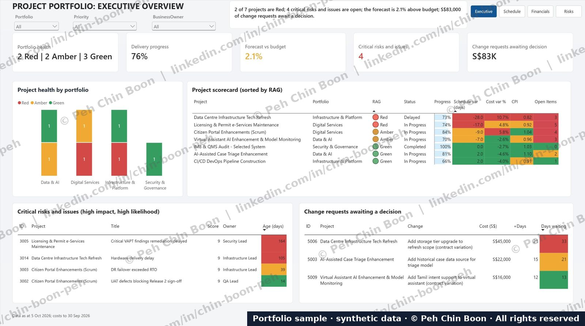
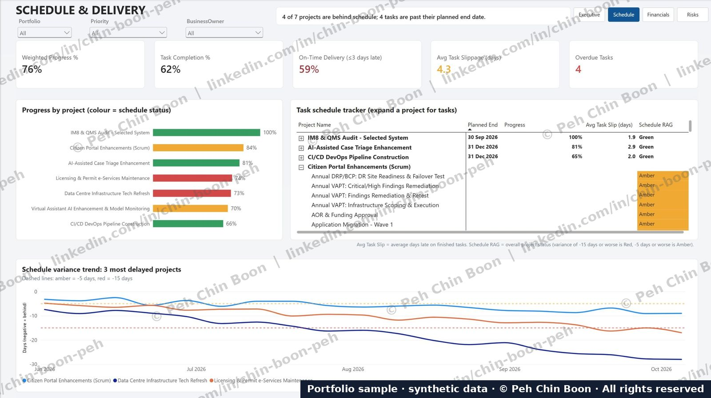
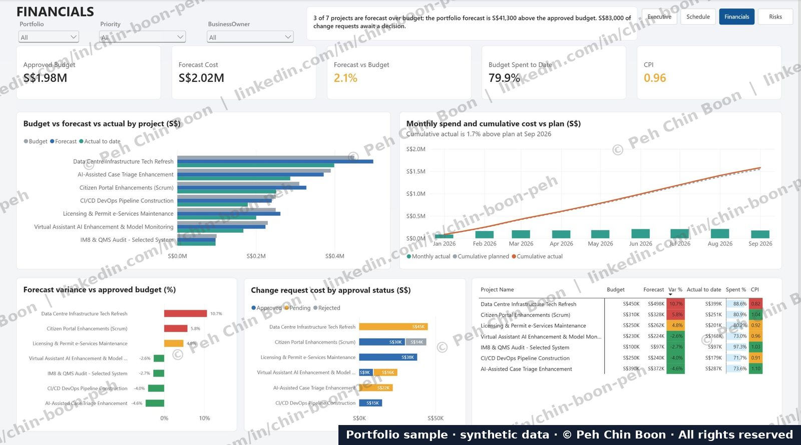
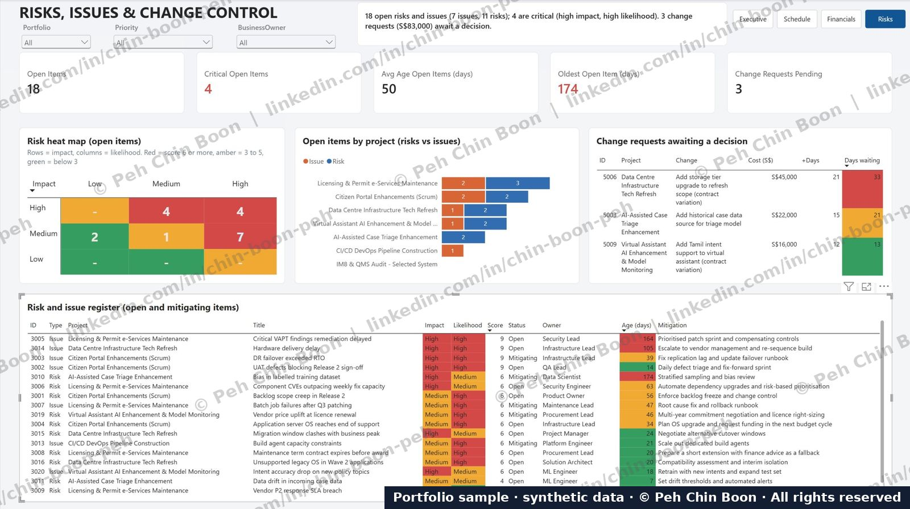

# Project Portfolio Tracking Dashboard (Power BI)

**A four-page Power BI dashboard that gives a PMO, programme director or steering committee a single view of a seven-project IT portfolio: health, schedule, cost, and risks/issues/change control.**

Built by **Peh Chin Boon** – IT project/programme manager (14+ years) moving into hybrid data and programme roles.
🔗 [LinkedIn](https://www.linkedin.com/in/chin-boon-peh/) (best way to reach me)

> **Note on the data:** All data is **synthetic**. It was generated to mimic a generic Singapore public-sector-style IT portfolio (e-services, data centre refresh, AI enhancements, DevOps, security and governance). It contains no real agency, vendor or personnel data.
> **Source file:** The `.pbix` and underlying datasets are **available upon request** via LinkedIn.

---

## Why I built this

Project managers report on portfolios every week, but most status packs are slides assembled by hand. I wanted to show I can do both sides: **know what a steering committee needs to decide**, and **build the data model and visuals that answer it** without manual re-work.

The design principle throughout: *each page opens with a one-line takeaway, then the KPIs, then the evidence.*

## The four pages

### 1. Executive Overview – "Where do I need to intervene?"

- Portfolio health at a glance: 2 Red, 2 Amber, 3 Green
- 76% delivery progress, forecast 2.1% above budget, 4 critical risks/issues, S$83K of change requests waiting
- RAG scorecard combining progress, schedule variance (days), cost variance %, CPI and open items, with conditional formatting so problems stand out
- Critical risks/issues (high impact × high likelihood) and pending change requests sit on the same page, so the decision list is visible without drilling in

### 2. Schedule & Delivery – "Who is slipping, and is it getting worse?"

- Weighted progress, task completion %, on-time delivery (≤3 days late), average slippage and overdue tasks
- Progress by project, coloured by schedule status
- Expandable task tracker (project → tasks) built with default visuals only – no custom Gantt
- Variance trend for the three most delayed projects, with amber (-5 days) and red (-15 days) threshold lines, showing that one project has deteriorated steadily since June 2026

### 3. Financials – "Are we on budget, and what is driving it?"

- Approved budget S$1.98M vs forecast S$2.02M (+2.1%), 79.9% spent, CPI 0.96
- Budget vs forecast vs actual by project
- Monthly spend and cumulative actual vs plan
- Forecast variance by project, and change-request cost split by approval status (approved / pending / rejected)

### 4. Risks, Issues & Change Control – "What could hurt us, and what is waiting on a decision?"

- 18 open items (7 issues, 11 risks), 4 critical, average age 50 days, oldest 174 days
- Impact × likelihood heat map using a transparent scoring rule (red ≥ 6, amber 3–5, green < 3)
- Open items by project, split by risks vs issues
- Full register with owner, age and mitigation; change requests ranked by days waiting

## Key insights the dashboard surfaces (from the sample data)

| Insight | Where it shows |
|---|---|
| Two of seven projects are Red, both well behind schedule (-28 and -17 days) | Executive, Schedule |
| The worst-slipping project also has the weakest cost performance (CPI 0.82, +10.7% forecast overrun) | Executive, Financials |
| Largest pending change request (S$45K) belongs to that same project and has waited 33 days | Executive, Risks |
| Cumulative actual spend is only 1.7% above plan, but the overrun is concentrated in three projects | Financials |
| The oldest open item is a 174-day-old data-bias risk on an AI project | Risks |

## Skills demonstrated

- **Portfolio / PMO reporting:** RAG logic, earned-value style metrics (CPI, schedule and cost variance), risk scoring, change-control ageing
- **Data modelling:** seven related tables (below) shaped into a model that supports page-level filters (Portfolio, Priority, Business Owner)
- **Dashboard design:** takeaway headline per page, page navigation buttons, consistent colour semantics, conditional formatting, and drill-down using standard Power BI visuals
- **Domain content:** annual VAPT, vulnerability management, DRP/BCP exercises, licence renewals, DevOps pipeline build, AI model-drift monitoring and IM8/QMS audit embedded as real project work, not bolted on

## Data model (schema only)

| Table | Purpose |
|---|---|
| Projects | Project master: portfolio, priority, business owner, budget, dates |
| Tasks | Task-level plan vs actual dates and progress |
| Project_Weekly_Snapshot | Weekly progress/variance history for trend lines |
| Financials_Monthly | Monthly planned and actual spend |
| Change_Requests | Cost/schedule impact and approval status |
| Risks_Issues | Register with impact, likelihood, owner, status |
| Resource_Utilisation | Capacity and utilisation by role |

## Tools

Power BI Desktop · Power Query · DAX · synthetic CSV datasets

## Use of this work

© 2026 Peh Chin Boon. **All rights reserved.** The screenshots are published for portfolio review only. Please do not copy, redistribute, or present this work as your own. See [LICENSE](LICENSE).

For the `.pbix` walkthrough or a live demo, message me on [LinkedIn](https://www.linkedin.com/in/chin-boon-peh/).
